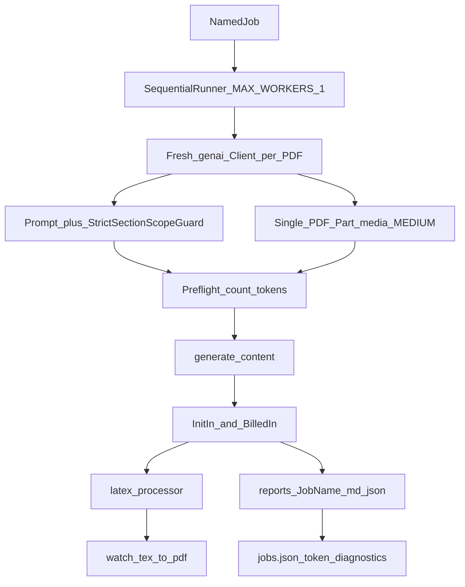

# Architecture — MathTex Gemini Automation

## Goal

`Overleaf/.pdf/.../Book PDF/*.pdf` → Gemini (Flex / Batch / Standard) → overwrite `Overleaf/.tex/.../<TargetSubfolder>/(Prefix) <stem>.tex` → compile via `watch_tex_to_pdf.py --file` → token/cost/compile reports named by job.

## Package layout

```text
MathTex/
├── .env                          # GEMINI_API_KEY (gitignored)
├── .env.example
├── requirements-automation.txt
├── run_automation.py / Run Automation.bat
├── run_jobs.py / Run Jobs.bat
├── automation/
│   ├── main.py                   # CLI + interactive orchestrator
│   ├── config.py                 # paths, pricing, MAX_WORKERS, media res
│   ├── ui_selector.py            # Tkinter + Questionary
│   ├── path_mapper.py            # RelPath, prefixes, section_number, topic
│   ├── gemini_runner.py          # isolated generate, batch lifecycle
│   ├── latex_processor.py        # fences + validation
│   ├── pdf_compiler_hook.py      # watch_tex_to_pdf subprocess
│   ├── reporter.py               # Rich + MD/JSON (InitIn/BilledIn)
│   ├── job_store.py              # named jobs in jobs.json
│   ├── jobs_manager.py           # Run Jobs TUI
│   ├── .state/
│   │   ├── jobs.json             # named local jobs
│   │   └── batch_jobs.json       # Gemini Batch API records
│   └── reports/                  # <Job Name>.md|.json
└── Overleaf/
    ├── Prompts/                  # *.txt with [TOPIC NAME]
    ├── System Instructions/      # user-supplied AI Studio instructions
    ├── watch_tex_to_pdf.py
    ├── .pdf/.../Book PDF/
    ├── .tex/.../{Homework|Problem Sets|Book Section}/
    └── .code/slice_pdfs.py       # manual prep; DO NOT change for bleed
```

## Module responsibilities

| Module | Role |
|--------|------|
| `config.py` | Roots, `FOLDER_PREFIX_MAP`, models, `MODEL_PRICING_PER_1M`, `MAX_WORKERS=1`, `PDF_MEDIA_RESOLUTION`, timeouts |
| `path_mapper.py` | Extract RelPath above `Book PDF`; resolve/create prefixed `.tex`; `derive_topic_name`; `extract_section_number` |
| `ui_selector.py` | PDF pick modes; multi-prompt join; system instruction; target folder; model/thinking/tier; PDF showcase table |
| `gemini_runner.py` | Fresh client per PDF; scope guard; media_resolution; preflight count_tokens; Flex retries; Batch create/wait/cancel; sequential runner |
| `latex_processor.py` | Fence strip; `OK` / `TRUNCATED_LATEX` / `MISSING_DOCUMENTCLASS`; UTF-8 write |
| `pdf_compiler_hook.py` | `subprocess` → `watch_tex_to_pdf.py --file` |
| `reporter.py` | SectionReport; InitIn/BilledIn; sanitize job filenames; write reports |
| `job_store.py` | Create/update named jobs; settings snapshot; token_diagnostics |
| `jobs_manager.py` | Interactive job list/inspect/cancel/wait |
| `main.py` | Entry: interactive, dry-run, --jobs, --batches, non-interactive flags |

## Path & prefix rules

Source: `.pdf/<Domain>/<Subject>/<Chapter>/Book PDF/<stem>.pdf`

1. `RelPath` = parents above `Book PDF`
2. Target dir = `.tex/<RelPath>/<TargetSubfolder>/`
3. If existing `*<stem>.tex` → overwrite; else create `(Prefix) <stem>.tex`
4. Prefix map: Homework→`(Homework)`, Problem Sets→`(Problem Set)`, Book Section(s)→`(Book Section)`, else `(FolderName)`

## Execution tiers

| Key | Behavior |
|-----|----------|
| `flex_batch_fallback` | Flex first; Batch for items that exhaust retries |
| `flex_only` | Flex only |
| `batch_only` | Submit Batch; Wait / Cancel / Exit |
| `standard` | Real-time, no flex service_tier |

## Runtime flow (post Phase E)



## Prompts on disk (session)

- `Math - Topics.txt`
- `Math - Topics - Proof and Probability.txt`
- `Math - Test Sections Questions.txt`
- `Math - Test Sections Questions - Proof and Probability.txt`
- `Strategic Problem Selection Prompt.txt`

## State records

**`jobs.json` (local named job):** id, name, status, settings snapshot (PDFs, prompts, system, model, thinking, tier, items), `gemini_batch_names`, `report_md`, `report_json`, `token_diagnostics`, section_count, error_summary.

**`batch_jobs.json` (Gemini Batch):** job_name, model, thinking_level, local_job_id, items meta, state.

## Compiler preference

Use `Overleaf/watch_tex_to_pdf.py` (SUBST short paths + mirror write). Prefer over `convert_tex_to_pdf.py` for single-file hooks.
