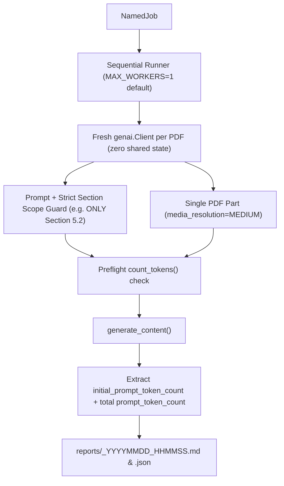

# Isolate Per-PDF Requests, Fix Continuation Token Reporting & Scope Guard, Name Reports by Job

## Root-Cause Diagnosis

### 1. Why Input Tokens Were 44k–73k Instead of ~3k–8k (`automatic_continuation` Hops)
In `google-genai` v3.3.0, `client.models.generate_content()` has `automatic_continuation=True` by default:
- When generating 36k–47k output tokens of LaTeX, the Gemini backend splits a single call across multiple internal **continuation hops** (`FinishReason.CONTINUATION` + `continuation_token`).
- Each hop re-feeds the prompt + all LaTeX generated so far as input context for the next hop.
- In `google.genai._extra_utils.merge_pydantic_models()`, the SDK **sums `prompt_token_count` across every continuation hop**, while saving the actual first-turn input size in `usage_metadata.initial_prompt_token_count`.
- That is why AI Studio showed ~3.3k–8k tokens (the single-turn initial input), whereas `usage_metadata.prompt_token_count` reported `44,910` – `73,696` (cumulative input billed across 2–4 continuation hops).

### 2. AI Studio vs API PDF Tokenization ("Media vs Text")
- Both AI Studio and the Gemini Developer API tokenize PDFs multimodally (page images + native text), **not** plain text stripping. Plain text extraction would break mathematical notation, matrices, and integral limits, so keeping native PDF input via `Part.from_bytes` is the right architecture.
- On Gemini 3 / 4 models, each PDF page costs `280` tokens (`LOW`), `560` tokens (`MEDIUM`), or `1,120` tokens (`HIGH`), plus System Instructions (~2,380 tokens) and the prompt (~1,875 tokens).
- Explicitly setting `media_resolution=PartMediaResolutionLevel.MEDIA_RESOLUTION_MEDIUM` on each PDF `Part` locks in Google's recommended `560` tokens/page and prevents implicit `HIGH` (`1,120`/page) escalation while preserving crisp math OCR.

### 3. Why Cross-Section Leakage Happened (Client Concurrency + Boundary Overlap Triggering Model Memory)
Your 1-page boundary overlap in [`.code/slice_pdfs.py`](d:\Users\Tashfeen Omran\Documents\Not Synced\GitHub\MathTex\Overleaf\.code\slice_pdfs.py) is intentional and **will not be changed**. Two mechanisms caused cross-section bleed:
1. **Shared `genai.Client` across threads during multi-hop continuations:** `run_items()` shared one `genai.Client` (`httpx.Client` pool) across `ThreadPoolExecutor(max_workers=3)` while `automatic_continuation` ran stateful `continuation_token` loops in parallel.
2. **Textbook boundary trigger + textbook memorization:** Because textbook pages share the end of Section $k$ and the start of Section $k+1$ (e.g., page 235 has Exercises 5.15–5.18 *and* the Section 5.3 header), and textbooks like Wackerly are in Gemini's pretraining weights, seeing the adjacent section header without a hard scope boundary causes the model to either solve the previous section's exercises on page 1 or continue generating into the next section's exercises from memory.

---

## Implementation Plan

### 1. Hard-Isolate Requests & Add Section Scope Guard
Files: [`automation/config.py`](d:\Users\Tashfeen Omran\Documents\Not Synced\GitHub\MathTex\automation\config.py), [`automation/path_mapper.py`](d:\Users\Tashfeen Omran\Documents\Not Synced\GitHub\MathTex\automation\path_mapper.py), [`automation/gemini_runner.py`](d:\Users\Tashfeen Omran\Documents\Not Synced\GitHub\MathTex\automation\gemini_runner.py)

- **Fresh Client per PDF section:** Pass `api_key` into `generate_one()` and instantiate a brand-new `genai.Client` inside each section call (closing/discarding it afterward) so two PDFs never share an HTTP session, connection pool, or SDK state.
- **Sequential execution by default:** Set `MAX_WORKERS = 1` in [`automation/config.py`](d:\Users\Tashfeen Omran\Documents\Not Synced\GitHub\MathTex\automation\config.py) so sections execute one fresh chat at a time in clean order (`1/N`, `2/N`, ...).
- **Explicit single-turn `types.Content`:** Construct `contents=[types.Content(role="user", parts=[types.Part.from_text(text=prompt), pdf_part])]` and assert `len(pdf_parts) == 1` before sending, printing an isolation log line:
  `[1/3] Isolated chat -> 5.2 Bivariate...pdf (12 pages, 125.9 KB, sha256=...)`
- **Strict Section Scope Guard (preserves your 1-page overlap slicing):** Extract the section prefix number (e.g., `5.2` from `5.2 Bivariate and Multivariate Probability Distributions.pdf`) in [`automation/path_mapper.py`](d:\Users\Tashfeen Omran\Documents\Not Synced\GitHub\MathTex\automation\path_mapper.py) and prepend a concise `--- STRICT SECTION SCOPE BOUNDARY ---` block to the user prompt:
  - Tells Gemini this isolated session is **exclusively** for `<SectionNumber> <Topic>`.
  - Explains that the first/last page of the attached PDF intentionally includes boundary overlap from the preceding or following section so nothing is cut off mid-sentence.
  - Strictly forbids solving exercises belonging to the preceding section on page 1 or continuing into the next section's text/exercises on the final page (and forbids recalling unattached textbook exercises from training memory).

### 2. Explicit PDF `media_resolution` & Transparent Token Accounting
Files: [`automation/config.py`](d:\Users\Tashfeen Omran\Documents\Not Synced\GitHub\MathTex\automation\config.py), [`automation/gemini_runner.py`](d:\Users\Tashfeen Omran\Documents\Not Synced\GitHub\MathTex\automation\gemini_runner.py), [`automation/reporter.py`](d:\Users\Tashfeen Omran\Documents\Not Synced\GitHub\MathTex\automation\reporter.py)

- **Lock PDF `media_resolution`:** In `_pdf_part()`, attach `media_resolution=types.PartMediaResolutionLevel.MEDIA_RESOLUTION_MEDIUM` (`560` tokens/page default, configurable via `PDF_MEDIA_RESOLUTION = "medium"` in `config.py` with `"low" | "medium" | "high"`).
- **Preflight token check:** Before `generate_content`, call `client.models.count_tokens()` on `[system_instruction + prompt, pdf_part]` so the console immediately prints the exact AI-Studio-equivalent single-turn input size (e.g., `Preflight input: ~5,061 tokens`).
- **Separate Initial Input vs Continuation Billed Input in Reports:** Update `usage_from_response()` and `SectionReport` in [`automation/reporter.py`](d:\Users\Tashfeen Omran\Documents\Not Synced\GitHub\MathTex\automation\reporter.py) to capture:
  - `initial_input_tokens`: `getattr(meta, "initial_prompt_token_count", None) or preflight_tokens` (matches AI Studio's input count).
  - `input_tokens`: `prompt_token_count` (total billed input across any SDK continuation hops).
  - Display both in the Rich summary table and Markdown/JSON reports (`InitIn` vs `BilledIn`) so you always see the true single-PDF size alongside any multi-hop continuation overhead, while computing USD cost accurately from billed tokens.

### 3. Name `.md` and `.json` Reports After the Job
Files: [`automation/reporter.py`](d:\Users\Tashfeen Omran\Documents\Not Synced\GitHub\MathTex\automation\reporter.py), [`automation/main.py`](d:\Users\Tashfeen Omran\Documents\Not Synced\GitHub\MathTex\automation\main.py), [`automation/jobs_manager.py`](d:\Users\Tashfeen Omran\Documents\Not Synced\GitHub\MathTex\automation\jobs_manager.py), [`automation/job_store.py`](d:\Users\Tashfeen Omran\Documents\Not Synced\GitHub\MathTex\automation\job_store.py)

- Add a Windows-safe filename helper `sanitize_job_filename(job_name: str)` in [`automation/reporter.py`](d:\Users\Tashfeen Omran\Documents\Not Synced\GitHub\MathTex\automation\reporter.py) (strips forbidden characters `<>:"/\|?*`, preserves readable spaces/dashes/dots like `Stats Chapter 6.1-6.3`, and appends timestamp only if a file with that exact job name already exists: `<Job Name>.md` / `<Job Name>.json`, or `<Job Name> (YYYYMMDD_HHMMSS).md` on collision).
- Include `Job Name` and `Job ID` at the top of the `.md` report and inside the `.json` root object.
- Thread `job_name` and `job_id` from `main.py` and `jobs_manager.py` (when downloading completed Batch jobs) into `write_reports(...)`, and store per-section token summaries (`initial_input_tokens`, `billed_input_tokens`) in `jobs.json`.

## Verification
1. Verify `sanitize_job_filename("Stats Chapter 6.1-6.3")` writes `automation/reports/Stats Chapter 6.1-6.3.md` and `.json` (with timestamp fallback on duplicate names).
2. Run preflight + dry-run check on Chapter 5 (`5.1`, `5.2`, `5.3`) confirming each work item creates an isolated single-PDF payload, injects the exact section scope (`5.1`, `5.2`, `5.3`), and leaves `.code/slice_pdfs.py` untouched.
3. Verify `usage_from_response` extracts both `initial_prompt_token_count` (~5k) and `prompt_token_count` cleanly.
